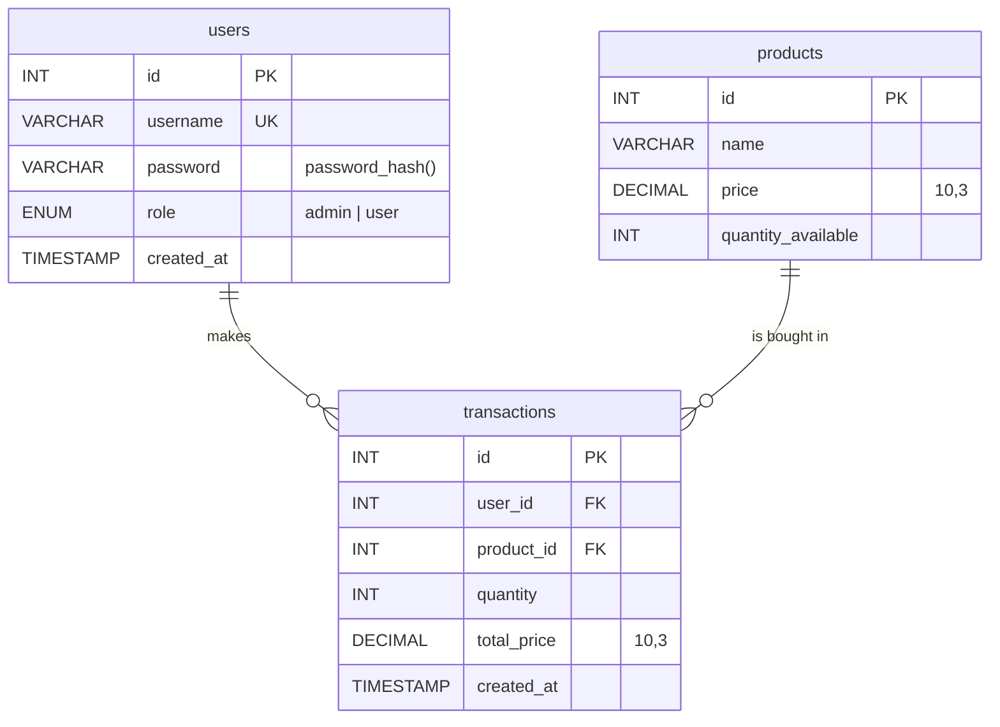

# Vending Machine (PHP + MySQL)

A vending machine web app and REST API written in plain PHP 8 (no framework). It covers product management, inventory tracking, purchases, session login with roles, and JWT login for the API.

- **Live demo:** _add the preview link here after deploying_
- **Demo accounts:** `admin / admin123` (Admin), `user / user123` (User)

---

## Contents

1. [Database design](#1-database-design)
2. [Setup](#2-setup)
3. [Project structure](#3-project-structure)
4. [How a request works](#4-how-a-request-works)
5. [Web routes](#5-web-routes)
6. [REST API](#6-rest-api)
7. [Validation](#7-validation)
8. [Tests](#8-tests)
9. [Security notes](#9-security-notes)
10. [Task checklist](#10-task-checklist)

---

## 1. Database design

MySQL database `vm_db` with three tables. The full script is [`database/schema.sql`](database/schema.sql).



### `products`: what the machine sells

| Column | Type | Notes |
|---|---|---|
| `id` | `INT AUTO_INCREMENT` | Primary key |
| `name` | `VARCHAR(100) NOT NULL` | e.g. Coke |
| `price` | `DECIMAL(10,3) NOT NULL` | **3 decimals**, because Pepsi costs 6.885 USD. `DECIMAL` is exact; `FLOAT` would give rounding errors with money |
| `quantity_available` | `INT NOT NULL DEFAULT 0` | Stock. It goes down with every purchase |

Seed data: Coke 3.99, Pepsi 6.885, Water 0.50 (10 of each).

### `users`: who can log in

| Column | Type | Notes |
|---|---|---|
| `id` | `INT AUTO_INCREMENT` | Primary key |
| `username` | `VARCHAR(50) NOT NULL UNIQUE` | Two users can't share a name |
| `password` | `VARCHAR(255) NOT NULL` | **Hash only**, made with `password_hash()` (bcrypt). Plain passwords are never stored. 255 leaves room for stronger future algorithms |
| `role` | `ENUM('admin','user') DEFAULT 'user'` | Controls what the user may do. `ENUM` means the database rejects any other value |
| `created_at` | `TIMESTAMP` | Set automatically |

### `transactions`: one row per purchase (the sales log)

| Column | Type | Notes |
|---|---|---|
| `id` | `INT AUTO_INCREMENT` | Primary key |
| `user_id` | `INT NOT NULL` | **Foreign key → `users.id`**: who bought |
| `product_id` | `INT NOT NULL` | **Foreign key → `products.id`**: what was bought |
| `quantity` | `INT NOT NULL` | How many |
| `total_price` | `DECIMAL(10,3) NOT NULL` | `price × quantity` **at the time of purchase**. It's stored rather than recalculated, so a later price change doesn't rewrite history |
| `created_at` | `TIMESTAMP` | When |

### Relationships

- **users 1 → many transactions:** a user can buy many times.
- **products 1 → many transactions:** a product can be bought many times.
- `transactions` links users and products: *who* bought *what*, *how many*, for *how much*.
- The **foreign keys** stop a product or user that has purchase history from being deleted, so the sales log never points to a missing row. The app catches this and shows *"Can't delete Coke: it has purchase history."* (web) or returns **409 Conflict** (API).
- MySQL adds an index on each foreign key automatically, which keeps "purchases of user X" queries fast.

### Overselling is not possible

Stock is reduced with a single conditional SQL statement:

```sql
UPDATE products
SET quantity_available = quantity_available - ?
WHERE id = ? AND quantity_available >= ?
```

If two people try to buy the last item at the same moment, only one `UPDATE` matches the row. The other gets "Not enough stock." and **no transaction is logged** for it. See [`ProductRepository::decreaseQuantity()`](src/ProductRepository.php) and [`PurchaseService`](src/PurchaseService.php).

---

## 2. Setup

**Requirements:** PHP 8.1+ (with `pdo_mysql`), MySQL 5.7+/8, Composer, and Apache with `mod_rewrite` (or PHP's built-in server).

```bash
# 1. get the code into your web root, e.g. MAMP: /Applications/MAMP/htdocs/vending-machine
cd vending-machine

# 2. install PHPUnit (dev only)
composer install

# 3. create the database, tables and the 3 products
mysql -u root -p < database/schema.sql

# 4. set your database login (and a new jwt_secret) in config/config.php

# 5. create the demo accounts (passwords are hashed)
php database/seed_users.php
```

Then open **http://localhost:8888/vm/products** (MAMP) or run it without Apache:

```bash
php -S localhost:8000 index.php      # → http://localhost:8000/products
```

> **MAMP:** `mod_rewrite` is off by default. Enable it by removing the `#` in front of
> `LoadModule rewrite_module modules/mod_rewrite.so` in `/Applications/MAMP/conf/apache/httpd.conf`, then restart MAMP.
> Without it, every page except the home page returns 404.

---

## 3. Project structure

```
vm/
├── index.php                 front controller: every request starts here
├── routes.php                all routes (web + API)
├── .htaccess                 sends URLs to index.php, blocks code folders
├── config/config.php         database + JWT settings
├── database/
│   ├── schema.sql            tables + seed products
│   └── seed_users.php        demo admin/user accounts
├── src/
│   ├── Database.php          PDO connection (one shared connection)
│   ├── ProductRepository.php       ┐
│   ├── UserRepository.php          ├ CRUD with prepared statements
│   ├── TransactionRepository.php   ┘
│   ├── ProductValidator.php  product rules (used by web + API)
│   ├── PurchaseService.php   buy logic: check → reduce stock → log (web + API)
│   ├── Auth.php              session login + roles
│   ├── JWT.php               create / verify tokens (HS256, written by hand)
│   ├── Router.php            URL → controller method, role checks
│   ├── Route.php             #[Route] attribute
│   ├── Controller.php        base for web controllers (render, redirect, flash)
│   ├── ProductsController.php      web: product CRUD + purchase
│   ├── AuthController.php          web: login / logout
│   ├── TransactionsController.php  web: purchase history
│   ├── ApiController.php           base for API controllers (JSON, token check)
│   ├── ProductsApiController.php   API: products + purchase
│   ├── AuthApiController.php       API: login → token
│   ├── TransactionsApiController.php API: purchase history
│   └── helpers.php           url(), slugify(), purchase_url(), config()
├── views/                    HTML templates (layout + pages)
├── assets/style.css
└── tests/                    PHPUnit tests
```

**Layers:** *Controller* (handles the request) → *Service / Validator* (business rules) → *Repository* (SQL) → *Database*.
Each layer only talks to the one below it, so each can be tested on its own.

---

## 4. How a request works

```
GET /vm/products/1/coke/purchase
  → .htaccess          not a real file → send to index.php
  → index.php          cut the path to "/products/1/coke/purchase", build controllers
  → Router             find the matching route, check the role in the session, call the method
  → ProductsController showPurchase(1, 'coke')
  → view               views/products/purchase.php inside views/layout.php
```

---

## 5. Web routes

All routes are in [`routes.php`](routes.php). Access is checked by the router using the role saved in the session (`$_SESSION['user']['role']`).

| Method | URL | Action | Who |
|---|---|---|---|
| GET | `/products` | List (pagination + sorting) | everyone |
| GET | `/products/create` | Add form | admin |
| POST | `/products` | Save new product | admin |
| GET | `/products/{id}/edit` | Edit form | admin |
| POST | `/products/{id}` | Save changes | admin |
| POST | `/products/{id}/delete` | Delete | admin |
| GET | `/products/{id}/{slug}/purchase` | Buy page | logged in |
| POST | `/products/{id}/{slug}/purchase` | Buy | logged in |
| GET | `/transactions` | Admin: all purchases · User: own purchases | logged in |
| GET/POST | `/login`, POST `/logout` | Session login | everyone |

**Attribute routing (Task 11).** The purchase routes are not listed in `routes.php`. They are declared on the controller methods and loaded by the router with Reflection:

```php
#[Route('GET', '/products/{id}/{slug}/purchase', access: 'login')]
#[Route('GET', '/products/{id}/purchase', access: 'login')]   // short URL → 301 to the one above
public function showPurchase(int $id, string $slug = ''): void
```

The URL contains the product name (`/products/1/coke/purchase`). A short or outdated URL **301-redirects** to the correct one, so search engines only ever see one URL per product.

**List page:** click a column header to sort (▲/▼). Pagination keeps the sort: `/products?sort=price&dir=desc&page=2`. The sort column is checked against a whitelist (`ProductRepository::SORTABLE`), so it can't be used for SQL injection.

---

## 6. REST API

Base URL: `/api`. JSON in, JSON out. CORS is enabled, so frontends on other domains can call it.

### Authentication (JWT)

```bash
curl -X POST http://localhost:8888/vm/api/login \
     -H "Content-Type: application/json" \
     -d '{"username":"admin","password":"admin123"}'
```
```json
{
  "token": "eyJhbGciOiJIUzI1NiIsInR5cCI6IkpXVCJ9.eyJzdWIiOjEs...",
  "token_type": "Bearer",
  "expires_in": 3600,
  "user": { "id": 1, "username": "admin", "role": "admin" }
}
```

Send the token with each protected request:

```bash
curl -X POST http://localhost:8888/vm/api/products/1/purchase \
     -H "Authorization: Bearer eyJhbGciOi..." \
     -H "Content-Type: application/json" \
     -d '{"quantity":2}'
```

The token is `HEADER.PAYLOAD.SIGNATURE`, signed with HMAC-SHA256 and the `jwt_secret` in the config ([`src/JWT.php`](src/JWT.php)). The payload holds the user id, username, role and expiry. Changing anything in the token (for example `"role":"user"` → `"admin"`) breaks the signature, and the token is rejected.

### Endpoints

| Method | URL | Auth | Success |
|---|---|---|---|
| POST | `/api/login` | – | 200 `{token, ...}` |
| GET | `/api/me` | token | 200 current user |
| GET | `/api/products?page=1&per_page=10&sort=price&dir=desc` | – | 200 `{data: [...], meta: {...}}` |
| GET | `/api/products/{id}` | – | 200 product |
| POST | `/api/products` | admin | 201 created product |
| PUT | `/api/products/{id}` | admin | 200 updated product |
| DELETE | `/api/products/{id}` | admin | 204 |
| POST | `/api/products/{id}/purchase` | token | 201 `{transaction_id, product, quantity, total}` |
| GET | `/api/transactions` | token | 200. Admin: all · User: own |

Product body for POST / PUT:

```json
{ "name": "Water", "price": 0.5, "quantity_available": 20 }
```

### Errors

Errors are always JSON: `{"error": "message"}`, plus `"errors": {field: message}` for validation.

| Status | When |
|---|---|
| 401 | No token, bad or changed token, expired token, wrong password |
| 403 | Valid token, but not an admin |
| 404 | Product or endpoint not found |
| 409 | Deleting a product that has purchase history |
| 422 | Validation failed / not enough stock |

---

## 7. Validation

The same rules apply on the web form and in the API ([`ProductValidator`](src/ProductValidator.php)):

| Field | Rule |
|---|---|
| name | required |
| price | required, a number, **greater than 0** |
| quantity_available | required, whole number, **0 or more** |
| purchase quantity | whole number, at least 1, not more than the stock |

- **Server-side:** always runs. Errors are shown in red under each field, and the typed values are kept.
- **Client-side:** HTML5 attributes (`required`, `min`, `step`) plus a small JavaScript check on blur and on submit, with the same messages. The form is never sent with bad data, but the server still checks, because JavaScript can be turned off.

---

## 8. Tests

```bash
vendor/bin/phpunit
```

**42 tests, 134 assertions** for `ProductsController` ([`tests/ProductsControllerTest.php`](tests/ProductsControllerTest.php)). They cover:

- **index:** first page, page out of range, no products, sorting, SQL injection in the sort column
- **store / update:** valid save, every invalid price and quantity (data providers), missing fields, typed values kept
- **delete:** success, product with purchase history, unknown id
- **purchase:** stock reduced and transaction logged, 3-decimal totals, buying the whole stock, invalid quantities, more than stock, sold out, *someone else bought it first* (no transaction logged), unknown id
- **SEO URL:** correct slug, wrong slug and short URL (301)

**Dependency injection + mocking.** The controller receives its repositories in the constructor, so the tests pass PHPUnit mocks instead of real repositories. **No database is needed**, and the suite runs in about 0.02 s.

```php
$this->products = $this->createMock(ProductRepository::class);
$this->products->method('find')->willReturn(self::COKE);
$this->transactions->expects($this->once())->method('create')->with(2, 1, 2, '7.980');
```

[`TestProductsController`](tests/TestProductsController.php) replaces only `render()`, `redirect()` and `notFound()`, which would print HTML or call `exit`, so the test can check what happened. All other code under test is the real code.

---

## 9. Security notes

| Risk | Protection |
|---|---|
| SQL injection | Prepared statements everywhere; sort columns checked against a whitelist |
| XSS | All output escaped with `htmlspecialchars()` |
| Stolen passwords | `password_hash()` / `password_verify()` (bcrypt) |
| Guessing usernames | Same "Wrong username or password." message for both cases |
| Session fixation | `session_regenerate_id()` on login and logout |
| Forged JWT | HMAC-SHA256 signature, `hash_equals()` compare, only `HS256` accepted (blocks the `alg: none` trick), expiry checked |
| Overselling | Conditional `UPDATE ... WHERE quantity_available >= ?` |
| Exposed code | `.htaccess` returns 403 for `src/`, `config/`, `vendor/`, `database/`, `tests/`, `views/` |
| Logout by a link on another site | Logout is POST only |

**Before going live:** set a new random `jwt_secret` and real database credentials in `config/config.php`.

---

## 10. Task checklist

| # | Task | Where |
|---|---|---|
| 1 | Database design | [Section 1](#1-database-design), [`schema.sql`](database/schema.sql) |
| 2 | PDO connection class + CRUD for products, users, transactions | [`Database.php`](src/Database.php), `*Repository.php` |
| 3 | Sessions + password hashing, Admin/User roles | [`Auth.php`](src/Auth.php), [`AuthController.php`](src/AuthController.php) |
| 4 | Role-based access from the session | `Router::checkAccess()` |
| 5 | `ProductsController` CRUD | [`ProductsController.php`](src/ProductsController.php) |
| 6 | Purchase: update stock + log transaction | `ProductsController::purchase()`, [`PurchaseService.php`](src/PurchaseService.php) |
| 7 | CRUD views, management admin-only | [`views/products/`](views/products/) |
| 8 | List with pagination + sorting | `ProductsController::index()`, [`views/products/index.php`](views/products/index.php) |
| 9 | Purchase view | [`views/products/purchase.php`](views/products/purchase.php) |
| 10 | Routing | [`routes.php`](routes.php), [`Router.php`](src/Router.php) |
| 11 | Attribute routing, SEO URLs | `#[Route]` on `showPurchase()` / `purchase()` |
| 12 | Validation rules | [`ProductValidator.php`](src/ProductValidator.php) |
| 13 | Server-side + client-side validation | Validator + JS in [`form.php`](views/products/form.php), [`purchase.php`](views/products/purchase.php) |
| 14 | PHPUnit tests | [`tests/ProductsControllerTest.php`](tests/ProductsControllerTest.php) |
| 15 | Dependency injection + mocking | Constructor injection + `createMock()` |
| 16 | REST API | [`src/*ApiController.php`](src/), [Section 6](#6-rest-api) |
| 17 | JWT authentication | [`JWT.php`](src/JWT.php), `ApiController::requireUser()` |
